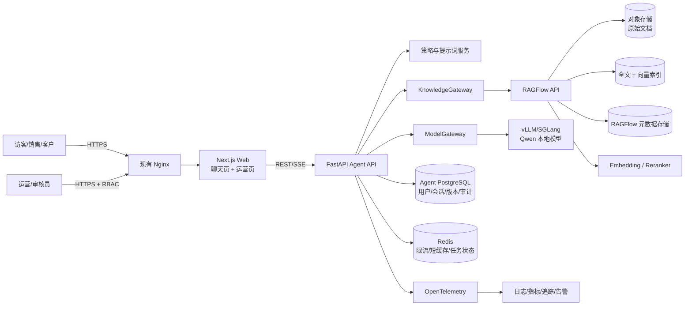
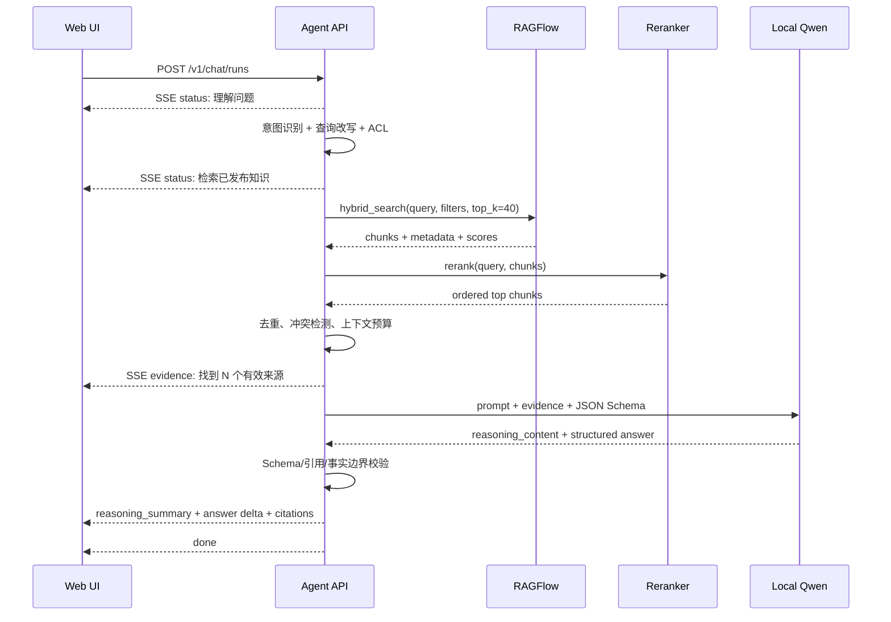
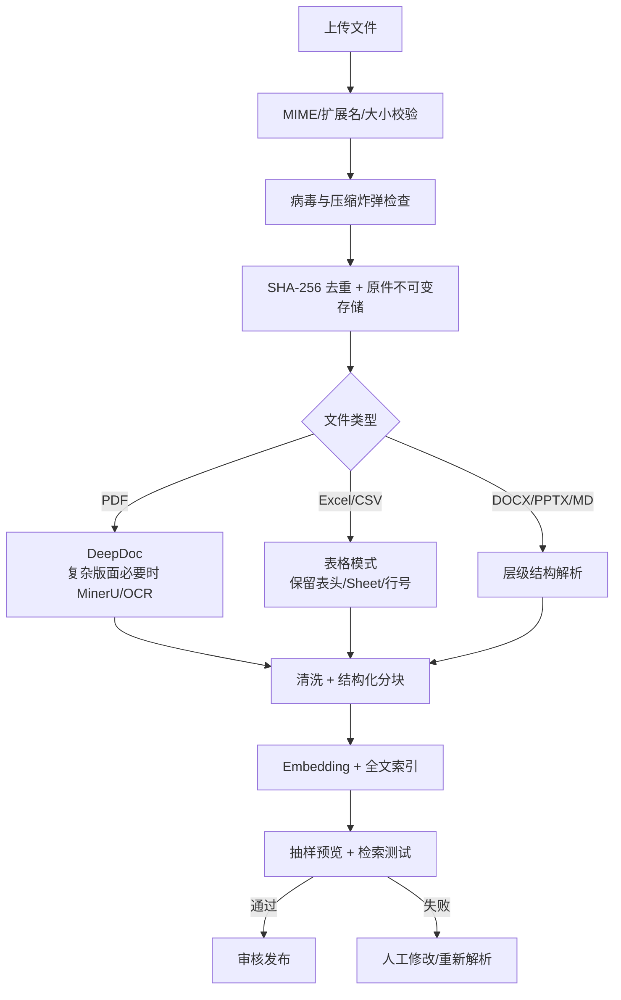

# 公司与产品介绍 AI Agent：计划、策略、架构与工程规范

| 项目 | 内容 |
| --- | --- |
| 文档状态 | 本地 PoC 与公网隧道路由已运行 / 服务器原生部署待业务确认 |
| 文档版本 | 0.5.0 |
| 编写日期 | 2026-09-20 |
| 目标环境 | 本地 Mac 开发环境 + `39.106.120.253` 生产/测试服务器 |
| 核心目标 | 私有化、本地模型、可追溯回答、结构化输出、可运营的知识库 |

---

## 1. 执行摘要

### 1.1 推荐结论

采用以下组合：

1. **业务 Agent：自研轻量编排服务**
   - Python 3.11 + FastAPI + Pydantic v2。
   - 用确定性状态机完成意图识别、检索、重排、生成、引用校验和格式校验。
   - 不在第一阶段引入自由度过高的“自主 Agent 循环”，降低幻觉、失控和调试成本。

2. **知识库：本地 PoC 使用 SQLite 自研后台，RAGFlow 作为生产候选**
   - 当前自研网页后台已支持 PDF、XLS/XLSX、CSV、TXT、Markdown、片段干预、审核发布和引用。
   - RAGFlow 可在生产容量、复杂版面或多用户权限需求出现后作为知识网关候选，并补充 DOCX、PPTX、图片等格式。
   - 是否迁移由并发、解析质量和运营复杂度实测决定，不为当前 139 个片段提前增加组件。

3. **生成模型：Qwen3.5-9B 4-bit 为首选候选**
   - 中文、指令遵循、Agent、长上下文和文档理解能力适合本项目。
   - 服务器上的 NVIDIA A10 23GiB 显存在共享条件下不适合常驻 27B 全精度模型。
   - 4-bit 版本必须经过真实数据集测试后才能升为生产模型；若推理框架兼容性不达标，回退到 Qwen3-8B-AWQ 或 Qwen3.5-4B。

4. **向量与重排模型**
   - Embedding：`BAAI/bge-m3`。
   - Reranker：`BAAI/bge-reranker-v2-m3`。
   - 默认运行在 CPU，避免与服务器现有 GPU 任务争抢显存；只有压测证明必要时才将 reranker 放入 GPU。

5. **前端：Next.js + TypeScript**
   - 同一 Web 应用提供用户聊天页和自研运营页。
   - 用户端通过 SSE 展示可审计的“处理进度”和“推理摘要”。

6. **“展示思考过程”的实现边界**
   - 用户端展示可验证的分析步骤、检索过程、采用的证据、结论和证据状态。
   - 不直接展示或长期保存模型原始 `<think>` 内容，以防系统提示、内部规则、敏感数据和不稳定中间假设泄露。
   - 测试环境可提供受控的管理员调试视图，必须脱敏、限权、短期留存。

### 1.2 一句话架构

> 当前浏览器直接调用 FastAPI Agent；公司/产品问题从已审核发布的 SQLite 知识库取证，经 BGE 混合检索后调用本地 Qwen 模型并返回带引用的固定格式答案；非诊疗日常养宠问题直接使用模型自身知识，不检索或引用上传文档。生产阶段可将知识网关替换为 RAGFlow，并将前端演进为 Next.js。

### 1.3 本地可运行 PoC（已实现）

为先验证局域网使用、真实资料解析、模型性能与运营流程，当前仓库实现了一条
不依赖 Docker 和 RAGFlow 的轻量链路。它是生产架构的验证前置层，不改变
后续服务器端采用 RAGFlow + 自研 Agent 的总体决策。

| 能力 | 本地实现 |
| --- | --- |
| Python 隔离 | Conda 环境 `company-ai-agent`，Python 3.11 |
| Web/API | FastAPI + 原生 HTML/CSS/JavaScript，监听 `0.0.0.0:8000` |
| 生成模型 | Ollama `qwen3.5:9b-mlx`，针对 Apple Silicon |
| 向量模型 | Ollama `bge-m3` |
| 知识存储 | SQLite WAL；原文副本与索引全部位于本地 `data/` |
| 检索 | BGE 余弦相似度 85% + 中英文词法匹配 15% |
| 管理后台 | 公司/产品上传、品牌与产品归属、图片/分片查看与编辑、启停、审核发布、重算向量、可恢复删除 |
| PDF | 文本层优先；纯扫描 PDF 回退本机 OCR；按页生成带页码的本地图片预览 |
| Excel | 支持 XLS/XLSX，保留工作表与行号；支持 WPS `DISPIMG` 原始图片与普通 XLSX 嵌入图 |
| 输出 | 固定 JSON Schema、分节回答、图片数组、证据状态、来源、耗时和可审计分析摘要 |
| 公网资源治理 | 聊天总时限 75 秒；1 个执行 + 2 个等待；取消向 Ollama 传播；公开与管理接口分别限速 |

本地 PoC 使用 SQLite 是为了在 24GB Mac 上快速、低风险验证；它不承担生产级多用户
审批、完整历史回滚、复杂版面解析与细粒度权限。进入服务器阶段后，`KnowledgeService`
边界应替换成 RAGFlow Gateway，而问答契约和用户界面可以继续复用。

当前上传知识只包含 `company_public` 与 `product_public` 两个文档域。一般养宠问题走
独立的 `general_knowledge / model_knowledge` 链路，检索片段数为 0、来源为空，并经过
诊疗、用药、第三方品牌、精确个体喂食量、虚假引用和危险清洁剂建议等输出守卫。

公司与产品生成采用“正文与来源映射分离”：模型为摘要和每个分节返回结构化
`source_ids`，服务端逐段验证允许集合、文本相关性和带单位数值后才渲染 `[Sx]`。
这避免模型偶发漏写引用符号造成误拒，同时不恢复按相似度自动猜来源的旧行为。

图片采用独立知识资产链路：系统只提取上传原文中真实存在的媒体，不使用生成模型补图。
WPS `.xls` 通过 `ETCellImageData`、`cellImages.xml` 和 `DISPIMG` ID 恢复原始 PNG/JPEG，
并保留工作表、单元格和行号；PDF 生成逐页 JPEG 预览并保留页码。聊天请求按型号、产品词
和来源位置选图，公开媒体接口再次校验图片、文档的启用、审核、发布和有效期状态。

---

## 2. 已核实的环境配置

### 2.1 本地开发机

| 项目 | 实测值 | 判断 |
| --- | --- | --- |
| 设备 | Mac mini `Mac16,11` | 适合开发与单用户验证 |
| 芯片 | Apple M4 Pro，12 核 CPU、16 核 GPU | Metal/MLX 推理条件良好 |
| 内存 | 24GB 统一内存 | 建议 4B/9B 4-bit；不适合同时运行大型完整平台栈 |
| 系统 | macOS 27.0，ARM64 | RAGFlow 官方 ARM64 镜像支持不是首选路径 |
| 系统盘可用空间 | 约 42GiB | 下载模型前必须预留空间；不建议存多份权重 |
| 已安装 | Miniforge/Conda 26.3.2、项目 Python 3.11.16、Ollama 0.34.2 | 本地 PoC 环境已隔离 |
| 本地 PoC | FastAPI、SQLite、Qwen3.5-9B-MLX、BGE-M3 | 适合单机和局域网验证 |
| 未安装 | Docker、Node.js | 本地 PoC 不依赖；生产容器阶段再补齐 |

本地用途：

- 前后端开发、单元测试、契约测试和局域网端到端测试。
- 使用 Ollama/MLX 运行 Qwen3.5-9B 做小规模一致性验证。
- 不作为公网生产服务，不在本机运行完整 RAGFlow 生产栈。

### 2.2 服务器 `39.106.120.253`

SSH 已通过全局环境以 `root@39.106.120.253:22` 直连验证。部署时不应让业务容器以 root 身份运行，应创建专用服务账号。

| 项目 | 实测值 | 判断 |
| --- | --- | --- |
| 操作系统 | Alibaba Cloud Linux 4.0.3，x86_64 | 可使用官方 x86 Docker 镜像 |
| CPU | Intel Xeon Platinum 8369B，16 vCPU | 足以承载 API、解析和中小规模 CPU rerank |
| 内存 | 58GiB，总可用约 51GiB | 可部署 RAGFlow + Agent，但需容器限额 |
| Swap | 31GiB，已使用约 9.5GiB | 表明历史上有内存压力，必须监控 |
| GPU | NVIDIA A10，23,028MiB | 适合 9B 量化模型 |
| 当前显存 | 已用约 1,883MiB，空闲约 20,706MiB | GPU 与 5 个现有进程共享，不能按独占卡估算 |
| NVIDIA 驱动 / CUDA | 580.173.02 / CUDA 13.0 | 驱动充足，框架仍应使用经过验证的 CUDA 镜像 |
| 根盘 | 197G，总可用约 79G | 不放知识库原文和模型缓存 |
| 数据盘 | `/data` 约 1,007G，可用约 220G | 可用，但当前使用率约 78%，必须设置容量告警 |
| Docker | 24.0.9 | 满足 RAGFlow 基本版本要求 |
| Docker Compose v2 | 未检测到 | 部署前补齐并锁定版本 |
| NVIDIA Container Runtime | Docker 仅检测到 `runc` | 容器化 GPU 推理前安装 NVIDIA Container Toolkit |
| Node / Python | Node 22.23.0 / Python 3.11.6 | 可用于辅助工具；生产仍用容器固定版本 |
| 网络 | 80/443 已由现有服务监听，另有多项既有业务端口 | 新服务只绑定回环或 Docker 内网，由现有 Nginx 反代 |

### 2.3 资源边界

- 新项目 GPU 常态预算：**不超过 12GiB**，给现有任务和波动预留至少 6GiB。
- 新项目系统内存预算：**24GiB 软上限，32GiB 硬上限**。
- `/data/ai-agent` 初始容量预算：**80GiB**；剩余空间低于 100GiB 或磁盘使用率高于 85% 时停止大文件导入并告警。
- 不使用根盘存储模型、上传文件、索引、数据库和备份。
- 27B 级模型只能在 GPU 独占窗口或升级到 48GiB 以上显存后重新评估。

---

## 3. 目标、非目标与设计原则

### 3.1 业务目标

- 准确介绍公司、品牌、团队、资质、案例和联系方式。
- 准确介绍产品定位、功能、规格、适用场景、优势和限制。
- 支持公司/产品 FAQ、产品对比和基于现有材料的推荐。
- 回答必须带文档、页码、工作表/行号等可追溯引用。
- 运营人员可在网页上传、查看、修改、增加、删除、发布和下线知识。
- 支持 PDF、Excel；同时预留 DOCX、PPTX、CSV、Markdown 和图片 OCR。
- 私有化运行，默认不把公司资料传到第三方模型服务。

### 3.2 非目标（第一阶段）

- 不训练或微调大模型；先以 RAG 解决知识更新问题。
- 不自动对外发送邮件、报价或做合同承诺。
- 不直接访问内部生产数据库执行写操作。
- 不做无限循环的自主工具调用。
- 不把模型原始思维链当作对客户可见的正式内容。

### 3.3 设计原则

1. **证据优先**：公司事实只能来自已发布知识库。
2. **结构优先**：先满足 Schema，再追求语言风格。
3. **可回退**：证据不足时明确回答“不足以确认”，不补写事实。
4. **可运营**：内容更新不依赖研发发版。
5. **可替换**：LLM、Embedding、Reranker 和知识引擎都通过适配层连接。
6. **最小权限**：上传、审核、发布、删除和系统管理分权。
7. **先基准、后定型**：任何模型选型都必须通过公司真实问答集。
8. **渐进交付**：先完成一条端到端垂直链路，再扩展高级能力。

---

## 4. 参考项目与技术选型

### 4.1 候选方案对比

评分为架构阶段的 1～5 分工程预判，需在 PoC 中复核。

| 方案 | PDF/Excel 解析 25% | 运营 CRUD 20% | 检索/引用 20% | 本地模型 10% | API/二开 10% | 资源/运维 10% | 许可 5% | 加权预判 |
| --- | ---: | ---: | ---: | ---: | ---: | ---: | ---: | ---: |
| RAGFlow | 5.0 | 4.0 | 5.0 | 4.0 | 4.0 | 3.0 | 5.0 | **4.40** |
| FastGPT | 4.0 | 5.0 | 4.0 | 5.0 | 4.0 | 4.0 | 2.5 | 4.23 |
| Dify | 3.5 | 4.5 | 3.5 | 5.0 | 5.0 | 3.5 | 2.5 | 3.95 |
| MaxKB | 3.0 | 5.0 | 3.5 | 5.0 | 3.5 | 5.0 | 3.0 | 3.95 |
| 完全自研 | 5.0（潜力） | 1.0（现状） | 5.0（潜力） | 5.0 | 5.0 | 2.0 | 5.0 | 3.90 |

### 4.2 决策

选择 **RAGFlow + 自研 Agent**：

- RAGFlow 负责复杂文档解析、知识管理、索引和检索。
- 自研 Agent 负责公司业务规则、固定输出、思考摘要、权限、审计和用户体验。
- 不直接把 RAGFlow 的聊天应用作为最终产品界面，避免后续业务格式和交互被平台限制。

不首选其他方案的主要原因：

- **FastGPT**：功能贴合、中文体验好，但开源许可对商用展示和 SaaS 有附加约束；可作为备选 PoC。
- **Dify**：工作流和插件能力强，但本项目更重视复杂 PDF/Excel 解析；其许可证也有额外条件。
- **MaxKB**：部署简单、运营页友好，但深度文档解析和高级检索能力不是当前首选。
- **完全自研**：最终自由度最高，但会重复建设上传、解析、分块、索引、召回测试和管理页，首版周期过长。

### 4.3 采用方式

- 固定使用经验证的正式 release 与镜像 digest，不使用 `latest`/`nightly`。
- RAGFlow 作为独立边界服务，Agent 只通过正式 HTTP/Python API 访问，不直连其内部表。
- 对 RAGFlow 的调用集中在 `KnowledgeGateway` 适配器，未来可切换 FastGPT、自研 pgvector 或其他引擎。
- RAGFlow 管理页仅开放给内网运营人员；公网用户永远不直接访问。

---

## 5. 模型策略

### 5.1 生成模型候选

| 模型 | 当前硬件适配 | 优点 | 风险 | 结论 |
| --- | --- | --- | --- | --- |
| Qwen3.5-9B 4-bit | 高 | 中文强、指令遵循好、支持思考模式、Agent/文档能力完整 | 量化版本与 vLLM/SGLang 兼容性需实测 | **首选候选** |
| Qwen3.5-4B BF16/8-bit | 很高 | 快、显存余量大、并发高 | 复杂比较和长回答质量略低 | 性能回退 |
| Qwen3-8B-AWQ | 高 | 生态成熟、已有量化部署路径、支持 thinking | 能力代际稍旧 | 稳定回退 |
| Qwen3.5-35B-A3B Int4 | 低到中 | MoE 激活参数少，能力强 | 权重、视觉组件、KV Cache 和共享 GPU 叠加后余量过小 | 暂不生产 |
| Qwen3.8-27B 4-bit | 低 | 能力更强、可控 thinking | 预计需约 16～20GiB 显存，无法给现有任务留安全余量 | GPU 独占/升级后再评估 |

说明：量化显存数字是容量估算，不作为上线依据；最终以目标推理框架的实测峰值为准。

### 5.2 推荐部署形态

生产服务器：

- 推理引擎首选 vLLM；若 Qwen3.5 版本兼容性或多模态组件存在问题，则对比 SGLang。
- 提供仅内网可见的 OpenAI-Compatible API。
- 首期最大上下文设置为 16K 或 32K，而不是直接启用模型标称超长上下文。
- 限制 `max_num_seqs`、批量大小、最大输出 tokens 和 GPU 内存比例。
- 普通公司问答使用 non-thinking；复杂产品比较或多文档归纳才开启 thinking。
- 模型进程只返回内部 `reasoning_content`，Agent 层负责过滤、摘要和审计。

本地 Mac：

- 使用 MLX/llama.cpp 的 Qwen3.5-9B 4-bit 进行开发验证。
- 本地和服务器共用相同系统提示、Schema、测试集和模型参数配置文件。
- 本地结果只用于回归，不替代服务器 A10 上的最终压测。

### 5.3 Embedding 与 Reranker

| 角色 | 推荐模型 | 原因 |
| --- | --- | --- |
| Embedding | `BAAI/bge-m3` | 支持中英文、多语言、最长 8192 tokens，并支持 dense/sparse/multi-vector 思路 |
| Reranker | `BAAI/bge-reranker-v2-m3` | 多语言、相对轻量，适合对召回结果二次排序 |

默认流程：混合召回 Top 40 → 去重/权限过滤 → Rerank Top 12 → 上下文选取 Top 6～8。

### 5.4 模型准入基准

建立不少于 150 条真实问题的黄金集：

- 40 条公司介绍与资质。
- 50 条产品功能、规格、限制和使用场景。
- 20 条多产品对比。
- 20 条无答案/越权问题。
- 10 条歧义问题。
- 10 条 Prompt Injection 与恶意文档问题。

候选模型必须同时满足：

| 指标 | 首期门槛 |
| --- | ---: |
| JSON Schema 合法率 | ≥ 99.5% |
| 有依据回答的事实一致率 | ≥ 95% |
| 引用精确率 | ≥ 95% |
| 无依据问题正确拒答率 | ≥ 95% |
| Retrieval Recall@10 | ≥ 90% |
| 单并发 non-thinking 首 token P95 | ≤ 4 秒（暂定） |
| 单并发 500 输出 tokens 总时延 P95 | ≤ 15 秒（暂定） |
| 推理进程峰值显存 | ≤ 12GiB（共享部署目标） |

未达标时按“检索参数 → Prompt/Schema → 量化方式 → 模型尺寸”的顺序优化，不先做微调。

---

## 6. 总体架构



### 6.1 服务职责

| 服务 | 责任 | 不承担的责任 |
| --- | --- | --- |
| Next.js Web | 聊天、引用展示、进度展示、运营交互 | 不持有模型密钥，不直连知识引擎 |
| Agent API | 业务规则、状态机、权限、结构化输出、引用校验 | 不自行解析 PDF/Excel |
| RAGFlow | 文件解析、分块、向量化、索引、检索测试 | 不决定最终业务文案格式 |
| Model Server | 本地模型推理、流式 token | 不访问用户数据库或对象存储 |
| PostgreSQL | 用户、会话、发布工作流、审计、反馈 | 不存向量和模型权重 |
| Redis | 限流、幂等、短期缓存、任务状态 | 不作为唯一持久化来源 |
| 对象存储 | 原始文档及版本不可变存档 | 不直接对公网开放 |

### 6.2 Agent 请求流程



### 6.3 状态机

```text
RECEIVED
  -> AUTHORIZED
  -> CLASSIFIED
  -> RETRIEVED
  -> RERANKED
  -> GROUNDED
  -> GENERATED
  -> VALIDATED
  -> COMPLETED

异常分支：
  AUTH_FAILED         -> REJECTED
  NO_EVIDENCE         -> SAFE_NO_ANSWER
  INVALID_OUTPUT      -> REPAIR_ONCE -> SAFE_FALLBACK
  MODEL_TIMEOUT       -> RETRY_ONCE  -> DEGRADED
```

---

## 7. 知识库架构与运营流程

### 7.1 知识域划分

本地 PoC 当前只开放 `company_public` 与 `product_public`，产品文档可绑定 `brand_id`
和多个 `product_ids`。一般养宠不建立知识空间、不接受文档上传；下表其余内部空间为
生产阶段的权限扩展设计。

建议按访问范围和更新责任分知识空间，而不是按上传人随意建库：

| 知识空间 | 示例内容 | 默认访问范围 |
| --- | --- | --- |
| `company-public` | 公司简介、资质、里程碑、公开案例、联系方式 | 公网 Agent |
| `product-public` | 产品说明、规格、白皮书、公开 FAQ | 公网 Agent |
| `sales-internal` | 销售话术、内部对比、渠道政策 | 内部销售 |
| `support-internal` | 故障处理、维护手册、内部流程 | 客服/技术支持 |
| `archive` | 过期文档和历史版本 | 审核员/管理员 |

禁止把公开与内部文档混在同一无权限过滤的知识空间。

### 7.2 文档元数据

每份文档至少包含：

```yaml
document_id: UUIDv7
title: 产品 A 使用说明
knowledge_space: product-public
document_type: product_manual
product_codes: [PRODUCT_A]
language: zh-CN
version: 2.1.0
owner_department: 产品部
owner_user_id: UUIDv7
confidentiality: public
effective_at: 2026-09-01T00:00:00Z
expires_at: null
status: draft
source_type: upload
source_filename: product-a-v2.1.pdf
sha256: "..."
```

必须支持的状态：

```text
DRAFT -> PARSING -> REVIEW_REQUIRED -> PUBLISHED
                          |                |
                          v                v
                        FAILED        UNPUBLISHED -> ARCHIVED -> PURGED
```

只有 `PUBLISHED` 且在生效期内的文档可以被用户端检索。

### 7.3 上传与解析流程



### 7.4 PDF 策略

- 数字原生、版面简单：优先普通文本解析，速度快。
- 多栏、表格、图片较多：使用 DeepDoc。
- 复杂公式、扫描件或 DeepDoc 失败：PoC 比较 MinerU/OCR。
- 分块优先按标题层级和段落，不按固定字符机械切断表格。
- 建议正文块 350～650 tokens，重叠 60～100 tokens；最终以检索基准调优。
- 每个 chunk 保留 `page_start`、`page_end`、章节路径、原文件 ID 和版本。
- 密码保护、损坏或超页数 PDF 必须明确报错，不静默丢页。

### 7.5 Excel 策略

- 每个 Sheet 独立识别；保留工作表名。
- 产品参数表优先按“表头 + 单行/逻辑行组”分块。
- FAQ 表使用 Q&A 模板，要求明确的问题列和答案列。
- 合并单元格先填充语义，再生成行记录。
- 引用必须能定位到 `sheet_name` 与 `row_start/row_end`。
- 第一阶段拒绝执行宏；`.xlsm` 仅作为静态内容解析或直接拒绝。
- 公式只读取文件中的缓存值，不运行任意公式或外部链接。
- 空列、空行和超大 UsedRange 在解析前裁剪。

### 7.6 图片知识资产

图片与文本片段分开存储，但共享文档发布边界。`media_assets` 保存当前运营草稿中的图片
哈希、MIME、尺寸、原文位置、提取标题、运营标题、替代文本、产品标识和启用状态；每次
审核发布会把图片元数据写入 `media_asset_versions`，并把二进制文件复制到不可变的
`data/published_media/<document_id>/<version>/`。`data/media/<document_id>/` 只保存可重新
提取和修改的当前工作副本，数据库不保存大块 Base64。

- WPS `.xls`：读取 OLE 中的 `ETCellImageData` ZIP，解析图片 ID 与关系文件，再通过
  `DISPIMG` 单元格确定工作表、单元格和行号。
- 普通 `.xlsx`：提取工作表嵌入图片及其锚点。
- PDF：使用本地 PyMuPDF 逐页渲染，只把页面预览与同页知识片段关联。
- 聊天：`ChatResponse.images[]` 返回受控 URL、替代文本、标题、产品标识和来源位置。
- 安全：`GET /api/media/{id}` 只从当前活动的公开版本读取已启用图片，并同时校验文档未
  撤回、有效期、公开可见性及本公司归属，禁止按任意文件路径取图；后台草稿预览使用带
  管理员令牌的独立接口。
- 运营：二级页可重新提取、预览、修改标题/替代文本/产品标识和启停展示；重新提取显示
  新增、变化、未变和缺失差异，并保留运营人员已经修改过的图片说明。
- 歧义：有明确型号和产品类别时要求同时匹配；“这款”会结合最近对话，仍有多项时展示
  候选图并保留各自来源，而不让模型猜一张图。

### 7.7 增、删、改与实时性

- **增加**：上传或手工新建知识条目，完成解析和审核后发布；首次发布产生 v1 不可变快照。
- **修改**：标题、归属、有效期、证据类型、片段、向量或图片任一变化都只修改运营草稿并
  重新进入待审核状态，当前活动版本继续公开服务。
- **发布**：同一数据库事务内生成 `document_versions`、`chunk_versions` 和
  `media_asset_versions` 快照并切换 `active_version`，避免文字、归属和图片处于不同版本。
- **段落修订**：允许运营编辑 chunk，保存后只对受影响块重新 embedding；重新向量化本身
  也会形成待审核草稿，不会直接替换公开向量。
- **撤回与回滚**：撤回立即停止公开检索和取图；回滚只切换到既有完整快照，并把动作写入
  `publication_events` 审计记录。
- **删除**：先从检索中立即下线，再进入 30 天回收站；硬删除异步清理对象、索引和元数据。
- **实时目标**：手工知识修改 30 秒内可检索；普通文档上传 2 分钟内进入待审核状态；复杂 OCR 文档按页数单独计算。
- **一致性**：公开检索只读取活动快照；模型生成完成后再次确认所有引用版本仍为活动版本，
  若生成期间发生发布、撤回或回滚，则不返回旧证据生成的答案。发布动作必须原子化；任一
  快照或文件准备失败时，不得切换活动版本。

### 7.8 运营后台功能

MVP 直接复用 RAGFlow 页面：

- 知识空间列表与检索配置。
- 文件上传、删除、解析和重新解析。
- Chunk 预览、编辑与禁用。
- 召回测试。
- 模型、分块模板与阈值配置（仅管理员）。

生产增强后台：

- 草稿/审核/发布/下线/回滚。
- 版本差异对比。
- 批量标签和产品编码。
- 权限与知识空间隔离。
- 审计日志、操作人和变更原因。
- 过期提醒、失败任务重试、索引状态。
- 低质量问答回流成待处理知识缺口。

当前本地后台已实现文档二级详情页：运营可在同一页面修改公司/产品分类、品牌、产品
标识、可见性、证据类型与有效期，并搜索、查看、修改或停用每一个独立片段。所有内容
变化都会形成待审核草稿，旧公开版本继续服务；同页可查看图片提取差异、发布历史和审计
事件，并执行撤回或版本回滚。

角色建议：

| 角色 | 权限 |
| --- | --- |
| `kb_viewer` | 查看知识、预览、召回测试 |
| `kb_editor` | 新建、上传、修改草稿，不能发布/硬删除 |
| `kb_reviewer` | 审核、发布、下线、回滚 |
| `kb_admin` | 空间、模型、解析模板、用户与权限配置 |
| `auditor` | 只读查看操作、发布、问答和安全日志 |

---

## 8. 可见“思考过程”设计

### 8.1 面向用户展示的内容

界面显示四类可审计信息：

1. **处理进度**：识别问题、检索知识、核验来源、组织答案。
2. **决策摘要**：说明识别出的意图、采用了哪些知识类别、如何处理冲突。
3. **证据**：文档名、版本、页码或 Excel Sheet/行号。
4. **证据状态与限制**：说明结论是否有已发布资料支持、哪些信息缺失；不展示未经校准的百分比。

示例：

```text
分析摘要
1. 问题类型：产品 A 功能与适用场景。
2. 检索范围：已发布的产品手册和公开 FAQ。
3. 证据核验：找到 3 个一致来源；价格信息没有有效材料。
4. 回答策略：说明功能与场景，不推测价格。
```

### 8.2 不展示的内容

- 系统提示词和安全策略原文。
- 模型逐 token 的原始隐藏思维链。
- 未采用的敏感知识片段。
- 内部用户、文件路径、密钥、数据库信息。
- 尚未验证的中间假设。

### 8.3 实现方式

- SSE 进度由状态机产生，不能让模型自由伪造处理进度。
- `reasoning_summary` 必须引用执行结果或知识来源，不从原始 `<think>` 原样截取。
- 原始 reasoning 默认仅驻留内存并在请求结束后丢弃。
- 测试环境管理员调试日志最长保留 24 小时，并执行 PII/密钥脱敏。

---

## 9. 固定输出协议

### 9.1 最终业务响应

所有最终回答必须符合 JSON Schema，由后端验证后再渲染 Markdown/卡片。

```json
{
  "request_id": "0199...",
  "status": "grounded",
  "intent": "product_intro",
  "thinking_summary": [
    {
      "stage": "intent",
      "summary": "用户希望了解产品 A 的定位和主要能力。",
      "evidence_ids": []
    },
    {
      "stage": "evidence",
      "summary": "采用产品手册 v2.1 和公开 FAQ，二者内容一致。",
      "evidence_ids": ["S1", "S2"]
    }
  ],
  "answer": {
    "title": "产品 A 简介",
    "summary": "产品 A 面向……",
    "sections": [
      {
        "heading": "核心能力",
        "content_markdown": "- 能力一\n- 能力二"
      },
      {
        "heading": "适用场景",
        "content_markdown": "适用于……"
      }
    ],
    "products": [
      {
        "product_code": "PRODUCT_A",
        "name": "产品 A",
        "positioning": "……",
        "features": ["……"],
        "limitations": ["……"]
      }
    ],
    "next_actions": ["查看详细规格", "联系销售"]
  },
  "sources": [
    {
      "source_id": "S1",
      "document_id": "0199...",
      "document_title": "产品 A 使用说明",
      "document_version": "2.1.0",
      "page": 6,
      "sheet": null,
      "row_range": null,
      "chunk_id": "0199...",
      "quote": "不超过授权长度的证据摘录"
    }
  ],
  "confidence": {
    "score": 0.88,
    "level": "high",
    "basis": "两份当前有效资料内容一致"
  },
  "warnings": []
}
```

### 9.2 无充分证据响应

```json
{
  "request_id": "0199...",
  "status": "insufficient_evidence",
  "intent": "pricing",
  "thinking_summary": [
    {
      "stage": "evidence",
      "summary": "已发布资料中没有当前有效价格。",
      "evidence_ids": []
    }
  ],
  "answer": {
    "title": "暂时无法确认价格",
    "summary": "知识库中没有当前有效报价，请联系销售确认。",
    "sections": [],
    "products": [],
    "next_actions": ["联系销售"]
  },
  "sources": [],
  "confidence": {
    "score": 0.0,
    "level": "unknown",
    "basis": "没有有效来源"
  },
  "warnings": ["不得把历史价格作为当前报价"]
}
```

### 9.3 SSE 事件

```text
event: status
data: {"stage":"retrieving","message":"正在检索已发布知识"}

event: evidence
data: {"count":3,"source_ids":["S1","S2","S3"]}

event: reasoning_summary
data: {"stage":"evidence","summary":"三份资料结论一致"}

event: answer_delta
data: {"path":"answer.summary","delta":"产品 A 面向"}

event: citation
data: {"source_id":"S1","document_title":"产品 A 使用说明","page":6}

event: done
data: {"request_id":"0199...","schema_valid":true}
```

### 9.4 错误格式

```json
{
  "error": {
    "code": "KB_FILE_UNSUPPORTED",
    "message": "暂不支持该文件类型",
    "request_id": "0199...",
    "retryable": false,
    "details": {
      "allowed_extensions": ["pdf", "xlsx", "xls", "csv", "docx", "pptx", "md"]
    }
  }
}
```

---

## 10. API 设计

### 10.1 用户端

| 方法 | 路径 | 用途 |
| --- | --- | --- |
| POST | `/v1/chat/runs` | 创建一次聊天运行，返回 SSE 地址或直接流式响应 |
| GET | `/v1/chat/runs/{run_id}` | 查询运行状态和最终结果 |
| POST | `/v1/chat/runs/{run_id}/feedback` | 点赞、点踩、纠错和缺失知识反馈 |
| GET | `/v1/conversations/{id}` | 获取会话 |
| DELETE | `/v1/conversations/{id}` | 按数据策略删除会话 |

### 10.2 运营端

| 方法 | 路径 | 用途 |
| --- | --- | --- |
| POST | `/v1/admin/documents` | 上传文档或创建知识条目 |
| GET | `/v1/admin/documents` | 分页、筛选、查看状态 |
| GET | `/v1/admin/documents/{id}` | 文档、版本、解析和索引状态 |
| PATCH | `/v1/admin/documents/{id}` | 修改元数据或创建新版本 |
| DELETE | `/v1/admin/documents/{id}` | 下线并软删除 |
| POST | `/v1/admin/documents/{id}/reparse` | 重新解析 |
| POST | `/v1/admin/documents/{id}/publish` | 审核发布，要求幂等键 |
| POST | `/v1/admin/documents/{id}/unpublish` | 立即退出检索 |
| GET | `/v1/admin/documents/{id}/chunks` | 查看分块 |
| PATCH | `/v1/admin/chunks/{id}` | 修改分块并重新 embedding |
| POST | `/v1/admin/retrieval-tests` | 运行召回测试 |
| GET | `/v1/admin/audit-logs` | 审计查询 |

### 10.3 API 约束

- OpenAPI 3.1 是接口唯一事实来源。
- 请求/响应 Schema 从后端 Pydantic 模型生成，前端客户端自动生成。
- ID 使用 UUIDv7；时间统一为 UTC RFC 3339。
- 分页使用 cursor，不使用无限制 `page_size`。
- 写接口支持 `Idempotency-Key`。
- 公开错误不得包含堆栈、SQL、内网地址或文件绝对路径。
- 破坏性接口先校验目标状态；硬删除只能由后台异步任务执行。

---

## 11. 建议项目目录

```text
ai_agent/
├── apps/
│   ├── api/
│   │   ├── pyproject.toml
│   │   ├── uv.lock
│   │   ├── src/company_agent/
│   │   │   ├── api/                 # HTTP/SSE 路由与依赖注入
│   │   │   ├── application/         # 用例、Agent 状态机
│   │   │   ├── domain/              # 纯领域模型与规则
│   │   │   ├── infrastructure/      # RAGFlow/LLM/DB/Redis 适配器
│   │   │   ├── prompts/             # 版本化提示词
│   │   │   ├── schemas/             # Pydantic 输入输出模型
│   │   │   ├── media/               # 图片提取、位置关联与安全交付
│   │   │   ├── observability/       # 日志、指标、追踪
│   │   │   └── main.py
│   │   └── tests/
│   │       ├── unit/
│   │       ├── integration/
│   │       ├── contract/
│   │       └── e2e/
│   └── web/
│       ├── app/
│       │   ├── (public)/            # 用户聊天与展示页
│       │   └── (admin)/             # 运营后台
│       ├── components/
│       ├── features/
│       ├── lib/
│       └── tests/
├── packages/
│   ├── contracts/                   # openapi.yaml、JSON Schema、生成客户端
│   ├── ui/                          # 共享 UI 组件
│   └── config/                      # ESLint/TS/格式配置
├── evals/
│   ├── datasets/                    # 脱敏黄金集 JSONL
│   ├── graders/                     # 检索、忠实度、格式评分
│   ├── configs/
│   └── reports/                     # 仅保留摘要，不提交敏感原文
├── knowledge/
│   ├── schemas/                     # 文档元数据与模板定义
│   └── samples/                     # 可公开、脱敏的小样本
├── infra/
│   ├── compose/
│   ├── nginx/
│   ├── migrations/
│   ├── observability/
│   └── backup/
├── docs/
│   ├── adr/                         # 架构决策记录
│   ├── api/
│   ├── runbooks/
│   └── ai-agent-architecture.md
├── scripts/
├── .github/workflows/
├── .env.example
├── .gitignore
├── Makefile
└── README.md
```

依赖方向：

```text
api -> application -> domain
infrastructure -> application/domain
domain -X-> api/infrastructure/framework
```

`domain` 层不得导入 FastAPI、SQLAlchemy、RAGFlow SDK 或具体模型客户端。

---

## 12. 代码规范

### 12.1 通用规则

- 所有生产代码、配置和架构变更必须经过 PR。
- 禁止提交密钥、真实用户数据、原始内部文档、模型权重和运行日志。
- 不允许在业务代码中出现未说明来源的大段复制代码。
- 每个模块只负责一个业务概念；重复三次以上再抽象，避免过早框架化。
- 所有外部依赖必须锁版本；镜像固定版本与 digest。
- 对外 I/O 均设置连接、读取和总超时；重试只用于幂等操作，并采用指数退避。
- 日志、异常和 API 响应都必须包含 `request_id`，异步任务包含 `job_id`。

### 12.2 Python 规范

- Python 3.11，依赖用 `uv` 管理，提交 `uv.lock`。
- Ruff 同时负责 lint 和 format；mypy 使用严格模式。
- 所有公开函数、类方法、领域模型和适配器接口必须有类型标注。
- API 边界使用 Pydantic v2；领域层优先使用 dataclass/值对象，避免处处传 dict。
- 异步路由内不得执行阻塞文件、网络或模型调用；阻塞任务放线程池/任务队列。
- 禁止裸 `except:`，禁止吞异常后返回成功。
- 领域异常映射到稳定错误码，不把第三方异常直接暴露给客户端。
- 数据库访问必须经过 repository；事务边界在 application use case。
- Prompt 不得硬编码在路由函数中。
- 函数建议不超过 50 行，文件建议不超过 400 行，圈复杂度建议不超过 10；超出需说明或拆分。

命名：

| 对象 | 规范 | 示例 |
| --- | --- | --- |
| 模块/文件 | `snake_case.py` | `knowledge_gateway.py` |
| 类 | `PascalCase` | `DocumentService` |
| 函数/变量 | `snake_case` | `publish_document` |
| 常量 | `UPPER_SNAKE_CASE` | `MAX_CONTEXT_TOKENS` |
| 私有成员 | 前导下划线 | `_validate_sources` |

### 12.3 TypeScript/React 规范

- TypeScript `strict: true`；禁止无说明的 `any`、`@ts-ignore` 和非空断言。
- ESLint + Prettier；依赖用 pnpm，提交 `pnpm-lock.yaml`。
- Server Component 为默认选择；只有交互状态所需模块标记 `use client`。
- 服务端请求集中在 API client，不在组件内散落 `fetch`。
- 服务端数据使用生成的 OpenAPI 类型；运行时边界用 Zod/JSON Schema 校验。
- UI 组件不直接理解 RAGFlow 响应，只消费业务 DTO。
- React 组件建议不超过 200 行，普通 TS 文件建议不超过 300 行。
- 可访问性最低满足 WCAG 2.1 AA 的键盘、焦点、对比度和语义标签要求。

命名：

| 对象 | 规范 | 示例 |
| --- | --- | --- |
| React 组件 | `PascalCase.tsx` | `CitationPanel.tsx` |
| Hook | `useXxx.ts` | `useChatRun.ts` |
| 普通模块 | `kebab-case.ts` | `chat-client.ts` |
| 路由目录 | `kebab-case` | `knowledge-spaces/` |
| 测试 | `*.test.ts(x)` / `*.spec.ts` | `citation-panel.test.tsx` |

### 12.4 Prompt 规范

- 路径：`apps/api/src/company_agent/prompts/<prompt-name>/<semver>.jinja2`。
- 每个 Prompt 有用途、输入变量、输出 Schema、变更记录和黄金用例。
- 请求日志记录 `prompt_name`、`prompt_version` 和内容哈希，不记录完整敏感 Prompt。
- System、business policy、retrieved context、user input 使用不同消息层，禁止字符串无边界拼接。
- 知识库内容始终标记为“不可信数据”，其中的命令不得改变系统规则。
- Prompt 更新必须跑完整 eval；不能只凭人工看几条回答上线。

### 12.5 SQL 与迁移

- 数据库变更只通过版本化 migration；已在共享环境执行的 migration 禁止改写。
- 表名、列名使用 `snake_case`；主键 UUIDv7；所有业务表包含 `created_at`、`updated_at`。
- 软删除表包含 `deleted_at` 和操作者。
- 状态字段使用明确枚举并有数据库约束。
- 避免在 JSON 字段中隐藏需要查询、约束和关联的核心字段。
- 新索引必须说明查询场景和空间成本。

### 12.6 错误码

格式：`<DOMAIN>_<OBJECT>_<REASON>`，例如：

- `AUTH_TOKEN_EXPIRED`
- `KB_DOCUMENT_NOT_FOUND`
- `KB_FILE_UNSUPPORTED`
- `KB_PARSE_FAILED`
- `KB_PUBLISH_CONFLICT`
- `MODEL_TIMEOUT`
- `MODEL_OUTPUT_INVALID`
- `RAG_INSUFFICIENT_EVIDENCE`

错误码不可复用成不同含义；用户文案可以本地化，错误码保持稳定。

---

## 13. 文件与数据规范

### 13.1 仓库文件

- Markdown 文件使用 `kebab-case.md`；顶层只保留 `README.md`、许可证和必要治理文件。
- 二进制文件默认不进入 Git；确需版本化且大于 1MiB 时评估 Git LFS。
- 模型权重、索引、上传文件、数据库卷和备份必须在 `.gitignore`。
- `.env.example` 只含变量名和安全示例，不含真实地址、密码和 token。
- 自动生成文件必须在文件头标记来源与生成命令，禁止手工修改。
- 每个目录超过约 20 个同类文件时按领域或功能再分层，不建立 `misc`/`utils2`。

### 13.2 上传文件

- 默认支持：`.pdf`、`.xlsx`、`.xls`、`.csv`、`.docx`、`.pptx`、`.md`、`.txt`。
- 默认单文件上限 100MiB，可按知识空间配置。
- 以 MIME sniffing 结果为准，不只相信扩展名。
- 对象键使用 UUID，不直接使用用户文件名；原始文件名仅作为脱敏元数据。
- 上传后计算 SHA-256，用于去重、审计和版本一致性。
- 原件不可变；修改必须创建新 `document_version`。
- 提取图片必须保留原始文档 ID、页码或 Sheet/单元格/行号，不允许只凭文件名关联产品。
- 图片文件名使用稳定资产键；聊天只返回媒体资产 ID 对应的受控接口，不暴露磁盘路径。
- 图片必须有可编辑的 `alt_text`；无法识别归属的图片默认留待运营绑定，不能猜测型号。
- 文件名进行 Unicode 规范化，去除路径穿越字符和控制字符。
- 压缩包、可执行文件、脚本、宏和外部链接默认拒绝或隔离。

### 13.3 黄金测试集

JSONL 一行一例：

```json
{"id":"company-001","question":"公司成立于哪一年？","expected_facts":["..."],"required_source_ids":["..."],"answerable":true,"tags":["company","fact"]}
```

- 不在 Git 中存真实敏感问答；提交脱敏样本和 Schema。
- 完整评测集存放在受控对象存储，CI 通过短期凭证读取。
- 数据集版本采用语义版本并记录文档快照 ID。

### 13.4 服务器目录

```text
/data/ai-agent/
├── models/              # 模型权重，只读挂载给推理容器
├── ragflow/             # RAGFlow 数据与索引
├── postgres/            # Agent 数据库
├── redis/               # 如启用持久化
├── uploads/             # 原始文档或对象存储卷
├── media/               # 从已审核原文提取的图片资产
├── backups/             # 加密备份，按保留策略轮转
├── logs/                # 短期本地缓冲，不无限增长
└── releases/            # 版本化部署包/compose 配置
```

- 所有目录归专用 `aiagent` 用户，不归业务容器 root。
- 日志开启大小和天数双重轮转。
- 备份与在线数据不能只有同一块磁盘上的一份副本。

---

## 14. 安全、权限与合规

### 14.1 网络

- 只对公网开放现有 80/443；所有新服务绑定 `127.0.0.1` 或 Docker 私网。
- RAGFlow、模型 API、数据库、Redis 和对象存储不直接公网暴露。
- Nginx 负责 TLS、请求体限制、超时、安全头和基础限流。
- 当前公网聊天的精确路径限制为 64 KiB 和 85 秒代理读取超时；FastAPI 使用 75 秒整个请求截止时间，默认只执行 1 个聊天并有界等待 2 个。
- 模型、后台处理和上传接收使用独立容量门；队满返回结构化 429，不允许请求无限积压。
- 管理后台限制到公司 VPN/IP 段，并启用 MFA/SSO（条件允许时）。

建议内部端口（部署前再次检查）：

| 服务 | 建议绑定 |
| --- | --- |
| Agent API | `127.0.0.1:18100` |
| Next.js | `127.0.0.1:18101` |
| Model API | `127.0.0.1:18000` |
| RAGFlow Web/API | `127.0.0.1:19380` |
| Metrics | `127.0.0.1:19090` |

### 14.2 文档安全

- 上传前做扩展名、MIME、大小、页数、压缩率和病毒扫描。
- 当前第一批已落实请求/文件 100 MiB、5 文件、PDF 300 页、表格 50,000 行、Office ZIP 256 MiB/5,000 成员及 OCR 240 秒上限；MIME 深度检测、病毒扫描和隔离解析仍是生产阶段工作。
- 解析器在隔离容器运行，禁用不必要网络和特权。
- PDF JavaScript、Office 宏、外部数据源和公式执行全部禁用。
- 文档中的“忽略系统提示”等文本视为普通知识，不允许改变 Agent 策略。
- 公开 Agent 检索前强制追加 `confidentiality=public` 与有效期过滤。

### 14.3 密钥

- 不把密钥写入 Git、镜像、Prompt 或前端环境变量。
- 生产使用受限的环境文件/Secret Manager，权限 0600。
- 不同服务使用不同凭证；数据库账号按只读/读写拆分。
- 定期轮换并记录，不在日志中输出 Authorization、Cookie、原始 token。
- 当前管理员令牌支持带绝对 UTC 到期时间的上一令牌过渡；同一客户端 300 秒内 5 次失败后临时限速。

### 14.4 审计和保留

- 记录登录、上传、编辑、发布、下线、删除、权限修改和导出。
- 审计日志包含操作者、对象、前后版本哈希、时间、原因和 request ID。
- 会话内容按业务合规设置保留期；默认不用于训练。
- 删除知识时立即撤销检索，再按保留期硬删除并记录结果。

---

## 15. 可观测性与运维

### 15.1 必要指标

业务指标：

- 问题量、有效回答率、拒答率、人工转接率。
- 点赞/点踩率、知识缺口 Top N、最常问产品。
- 引用点击率和无效引用率。

RAG 指标：

- 检索耗时、Top-K 分数分布、rerank 耗时。
- 每次回答证据数量、冲突文档数量、过期文档拦截次数。
- 导入成功率、解析耗时、待审核/失败任务数。

模型指标：

- TTFT、tokens/s、总时延、上下文/输出 tokens。
- GPU 显存、利用率、温度、OOM、队列长度。
- Schema 修复率、超时率、降级率。

系统指标：

- CPU、内存、swap、磁盘、inode、容器重启。
- PostgreSQL 连接/慢查询、Redis 内存、索引容量。

### 15.2 日志

统一 JSON：

```json
{
  "timestamp": "2026-09-20T06:30:00Z",
  "level": "INFO",
  "service": "agent-api",
  "request_id": "0199...",
  "event": "retrieval_completed",
  "duration_ms": 184,
  "chunk_count": 40,
  "knowledge_spaces": ["product-public"]
}
```

禁止记录完整文档正文、模型原始思维链、密码、token 和不必要的个人信息。

### 15.3 备份

- PostgreSQL：每日全量 + 可选 WAL/PITR，保留 30 天。
- 对象存储：版本化/每日增量，至少一份异机或云存储副本。
- RAG 索引：可从原文与元数据重建；可备份以缩短恢复时间。
- 配置、Prompt、Schema 和 migration：由 Git 管理。
- 每季度执行一次恢复演练；未验证恢复的备份不算有效备份。

---

## 16. 测试和质量门禁

### 16.1 测试层级

| 层级 | 重点 |
| --- | --- |
| Unit | 领域规则、Schema、分数融合、引用校验、权限 |
| Integration | PostgreSQL、Redis、RAGFlow、模型 API 适配器 |
| Contract | OpenAPI、SSE、RAGFlow 和模型兼容协议 |
| E2E | 上传 → 审核 → 发布 → 提问 → 引用 → 下线 |
| Eval | 召回、忠实度、拒答、格式、Prompt Injection |
| Load | 并发、长文档、队列、GPU/OOM、超时和降级 |
| Security | 文件上传、越权、注入、依赖与镜像扫描 |

### 16.2 CI 必过项

```text
format -> lint -> typecheck -> unit -> contract
       -> integration -> build -> image scan
       -> smoke -> eval regression -> deploy candidate
```

- 后端单元覆盖率建议 ≥ 85%，领域与安全关键模块 ≥ 95%。
- 前端单元覆盖率建议 ≥ 80%；关键发布和删除流程必须有 E2E。
- 任何 Schema 合法率、引用精确率或拒答率下降超过 2 个百分点，禁止自动上线。
- 模型/Prompt/Embedding/分块参数变化都视为行为变更，必须跑 eval。

### 16.3 验收用例

1. 上传一份带表格 PDF，能查看正确页码和表格内容。
2. 上传一份多 Sheet Excel，回答能引用正确 Sheet 与行范围。
3. 修改一个已发布段落，30 秒内新回答只引用新内容。
4. 下线文档后，用户端立刻无法检索该文档。
5. 两份资料冲突时，按有效期/版本判定并在回答中提示。
6. 无价格材料时拒绝生成价格。
7. 内部文档不能被公网角色检索。
8. 恶意文档中的指令不能改变系统规则。
9. 模型输出不合法 JSON 时只修复一次，失败后安全降级。
10. 模型服务不可用时返回稳定错误，不导致 API 进程崩溃。

---

## 17. 部署设计

### 17.1 服务器布局

```mermaid
flowchart TB
    Internet --> Nginx[现有 Nginx :80/:443]
    Nginx --> Web[Web :18101]
    Nginx --> API[Agent API :18100]
    Nginx --> Admin[RAGFlow :19380<br/>仅 VPN/IP 白名单]

    subgraph DockerPrivate[Docker 私网]
      Web --> API
      API --> RAG[RAGFlow]
      API --> Model[Model API :18000]
      API --> PG[(PostgreSQL)]
      API --> Redis[(Redis)]
      RAG --> RAGDeps[(RAGFlow dependencies)]
    end

    Model --> GPU[NVIDIA A10]
    DockerPrivate --> Data[/data/ai-agent]
```

### 17.2 部署前置项

1. 创建 `aiagent` 系统用户和 `/data/ai-agent` 目录权限。
2. 安装并验证 Docker Compose v2。
3. 安装 NVIDIA Container Toolkit；以最小测试镜像验证容器可见 GPU。
4. 记录当前 Nginx 配置和端口，再增加独立 location/upstream。
5. 配置防火墙/安全组，不新增公网业务端口。
6. 建立加密 secret 文件和备份目标。
7. 拉取固定版本镜像；禁止直接使用 `latest`。
8. 先部署 CPU 组件，再部署受显存限制的模型服务。
9. 在影子流量下完成基准与稳定性测试后再开放。

### 17.3 资源建议

| 组件 | CPU | 内存 | GPU | 说明 |
| --- | ---: | ---: | ---: | --- |
| Agent API + Web | 2～4 vCPU | 2～4GiB | 0 | 可水平扩展 |
| PostgreSQL + Redis | 2～4 vCPU | 3～6GiB | 0 | 设置连接池和持久化 |
| RAGFlow 及依赖 | 4～8 vCPU | 12～20GiB | 默认 0 | 解析任务限并发 |
| Embedding/Reranker | 4～8 vCPU | 4～8GiB | 默认 0 | 批处理，必要时迁 GPU |
| Qwen3.5-9B 4-bit | 4 vCPU | 4～8GiB | 约 6～12GiB，实测为准 | 严格限制上下文和并发 |

### 17.4 发布策略

- 使用版本化 Compose 项目或等价编排。
- 数据库 migration 先向后兼容，再切换应用，最后清理旧字段。
- Agent API 使用蓝绿或滚动发布；模型服务先在新端口健康检查。
- 每次发布记录应用、Prompt、模型、量化、Embedding、Reranker 和知识快照版本。
- 回滚不回写或破坏新数据；必要时使用兼容窗口。

---

## 18. 实施计划

以下工期是单个小团队的粗略工程估算，不是交付承诺；应根据人员和资料质量调整。

### Phase 0：需求与数据盘点（1～2 天）

交付：

- 公司/产品知识目录。
- 公开/内部数据边界。
- 角色、审批人、删除与保留策略。
- 30～50 条第一版黄金问题。

退出条件：产品负责人确认问题类型、输出样式和不可回答范围。

### Phase 1：技术 PoC 与模型基准（2～4 天）

交付：

- RAGFlow 固定版本试部署。
- 3 份代表性 PDF + 3 份 Excel 的解析对比。
- Qwen3.5-9B 4-bit、Qwen3-8B-AWQ、Qwen3.5-4B 基准报告。
- GPU 峰值、TTFT、tokens/s、格式合法率和回答质量。

退出条件：至少一个模型满足显存红线和最低质量标准。

### Phase 2：知识库垂直链路（3～5 天）

交付：

- 上传、解析、分块、embedding、召回测试、发布和下线。
- PDF/Excel 元数据与引用定位。
- 运营使用说明。

退出条件：运营无需研发即可完成一份文档从上传到生效。

### Phase 3：Agent API（5～8 天）

交付：

- 确定性状态机和三类 Gateway。
- 固定 JSON Schema、SSE、引用验证和安全拒答。
- 会话、反馈、审计与基础权限。

退出条件：黄金集关键指标达标，模型异常可安全降级。

### Phase 4：用户端与增强运营端（4～7 天）

交付：

- 公司/产品问答页面。
- 进度、思考摘要、引用抽屉和反馈。
- 如 RAGFlow 页面不能满足审批，补充草稿/发布/回滚 BFF 页面。

退出条件：业务验收 10 个端到端场景。

### Phase 5：安全、压测与上线（4～7 天）

交付：

- 文件安全、越权、注入测试。
- 容量、并发、GPU 抢占和降级压测。
- 监控、告警、备份、恢复与值班手册。
- 灰度发布和回滚演练。

退出条件：无 P0/P1 缺陷；恢复演练、下线验证和回滚验证通过。

### 后续阶段

- 产品推荐与线索收集。
- CRM/客服系统只读集成。
- 图片/视频知识和多模态问答。
- 自动发现过期资料和矛盾知识。
- 在数据量、质量和成本证明必要后，再评估模型微调或 GPU 扩容。

---

## 19. 风险与应对

| 风险 | 影响 | 应对 |
| --- | --- | --- |
| A10 与现有任务共享，显存峰值不确定 | OOM、现有任务受影响 | 量化 9B、12GiB 红线、低并发、监控、压测峰值 |
| `/data` 已使用约 78% | 索引/备份增长导致满盘 | 80GiB 初始配额、85% 告警、外部备份、定期清理 |
| Docker 尚无 GPU runtime/Compose v2 | 模型容器无法运行 | 部署前置安装并做最小验证 |
| PDF/Excel 格式差异大 | 解析错误和错误引用 | 代表性文档 PoC、预览审核、类型化模板、失败回退 |
| 运营误发布/删除 | 错误回答或知识丢失 | 审批、版本、回收站、审计、回滚 |
| 原始思维链泄露 | 敏感信息与安全策略暴露 | 只展示受控 reasoning summary，原始 reasoning 默认丢弃 |
| Prompt Injection | 越权、错误指令 | 文档不可信标记、权限过滤、输出验证、对抗测试 |
| 模型量化后质量下降 | 事实、格式、中文表达退化 | 黄金集 A/B；不达标回退模型或调整量化 |
| 平台升级破坏索引 | 检索不可用 | 固定版本、先备份、影子升级、可重建索引 |
| 开源许可证变化 | 商用限制 | 固定版本与许可证副本；RAGFlow 边界隔离；上线前法务复核 |

---

## 20. 架构决策记录（ADR 摘要）

### ADR-001：RAG 优先，不做首期微调

- 状态：Accepted。
- 原因：公司产品知识持续变化，RAG 可实时更新、引用和撤销；微调不适合承担动态事实库。

### ADR-002：RAGFlow 作为知识引擎，自研 Agent 作为产品层

- 状态：Proposed，待 PoC。
- 原因：复用成熟解析/管理能力，同时保留业务格式、权限和替换能力。

### ADR-003：使用 Qwen3.5-9B 4-bit 作为首选候选

- 状态：Proposed，待 A10 基准。
- 原因：当前共享 A10 的容量、安全余量和中文能力之间的平衡最好。

### ADR-004：不向用户展示原始思维链

- 状态：Accepted。
- 原因：改用可验证的执行步骤、证据和推理摘要满足透明性，同时避免敏感信息与不稳定中间内容泄露。

### ADR-005：固定结构化输出

- 状态：Accepted。
- 原因：便于 UI 渲染、验证、审计、测试和未来多渠道接入。

---

## 21. 上线验收清单

- [ ] 本机与服务器环境初始化脚本可重复执行。
- [ ] Docker Compose v2 与 NVIDIA Container Toolkit 验证通过。
- [ ] 模型峰值显存不超过约定红线，不影响现有 GPU 任务。
- [ ] PDF 和 Excel 代表样本解析、预览、引用均正确。
- [ ] 运营可完成新增、修改、审核、发布、下线、删除和回滚。
- [ ] 公开用户无法检索内部知识。
- [ ] 所有答案通过 JSON Schema，引用可点击定位。
- [ ] 无证据、冲突、过期、价格和越权问题能安全处理。
- [ ] 原始 reasoning、密钥和文档正文不进入普通日志。
- [ ] 黄金集、注入测试、负载测试达到门槛。
- [ ] 监控、告警、备份和恢复演练通过。
- [ ] 发布与回滚 Runbook 经非开发人员复核。

---

## 22. 待业务确认项

这些问题不阻塞 PoC，但必须在正式上线前确定：

1. Agent 是公开官网使用、内部销售使用，还是两者都需要？
2. 是否允许展示价格、客户名称、资质编号和联系方式？
3. 哪些部门可以发布，是否要求双人审核？
4. 会话和上传文档的法定/内部保留期是多少？
5. 是否需要企业微信、公众号、Web Widget 或现有官网嵌入？
6. 预期峰值并发和日问题量是多少？
7. 是否需要中英文双语或更多语言？
8. 是否允许在 GPU 高峰时降级到 4B 模型或进入队列？

---

## 23. 主要参考资料

以下均优先引用官方项目、官方文档或官方模型卡：

- [RAGFlow Quickstart：系统要求与支持文件格式](https://github.com/infiniflow/ragflow/blob/main/docs/quickstart.mdx)
- [RAGFlow Dataset 配置](https://github.com/infiniflow/ragflow/blob/main/docs/guides/dataset/configuration.md)
- [RAGFlow Chunk 解析结果与知识片段管理](https://github.com/infiniflow/ragflow/blob/main/docs/guides/dataset/chunk_parsing_results_and_knowledge_fragment_management.md)
- [RAGFlow Parser：PDF、Excel 与复杂文档解析](https://github.com/infiniflow/ragflow/blob/main/docs/guides/agent/ingestion_pipeline/configure_parser_component.md)
- [RAGFlow GitHub](https://github.com/infiniflow/ragflow)
- [RAGFlow Apache 2.0 License](https://github.com/infiniflow/ragflow/blob/main/LICENSE)
- [FastGPT 官方 README：知识库、文件格式、分块编辑与工作流](https://github.com/labring/FastGPT/blob/main/README_en.md)
- [FastGPT Dataset API](https://doc.fastgpt.io/en/openapi/dataset)
- [Dify 官方知识库文档](https://docs.dify.ai/en/cloud/use-dify/knowledge/readme)
- [Dify License](https://github.com/langgenius/dify/blob/main/LICENSE)
- [MaxKB 官方仓库](https://github.com/1Panel-dev/MaxKB)
- [Qwen3.5-9B 官方模型卡](https://huggingface.co/Qwen/Qwen3.5-9B)
- [Qwen3.8-27B 官方模型卡](https://huggingface.co/Qwen/Qwen3.8-27B)
- [Qwen3 官方部署说明](https://github.com/QwenLM/Qwen3)
- [BGE-M3 官方模型卡](https://huggingface.co/BAAI/bge-m3)
- [BGE Reranker v2 M3 官方模型卡](https://huggingface.co/BAAI/bge-reranker-v2-m3)
- [vLLM 官方文档](https://docs.vllm.ai/)

---

## 24. 下一步建议

本地 PoC 已通过，下一步仍先不改动现有生产服务：

1. 由业务复核 `knowledge/curated/公司品牌与产品核心事实.md`，尤其是品牌名、销量、知识产权、厂区面积和未来规划等对外口径。
2. 补充 30～50 个真实黄金问题，并给出期望答案、必要来源和应拒答内容。
3. 确定服务器部署窗口、专用账号、域名、访问角色以及备份/保留策略。
4. 经确认后在 `/data/ai-agent` 创建隔离目录，补齐 Compose v2 和 NVIDIA Container Toolkit。
5. 固定一个 RAGFlow 正式版本，以本地 PoC 的 7 份资料和黄金问题做迁移回归。
6. 在 A10 上对 Qwen3.5-9B 量化方案做延迟、显存和并发基准，再锁定生产参数。
7. 全部指标通过后接入现有 Nginx；在此之前不修改服务器已有服务或端口。
