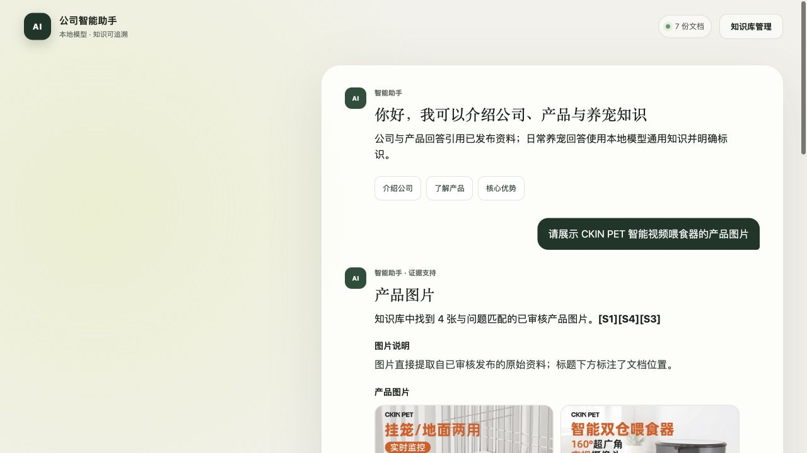
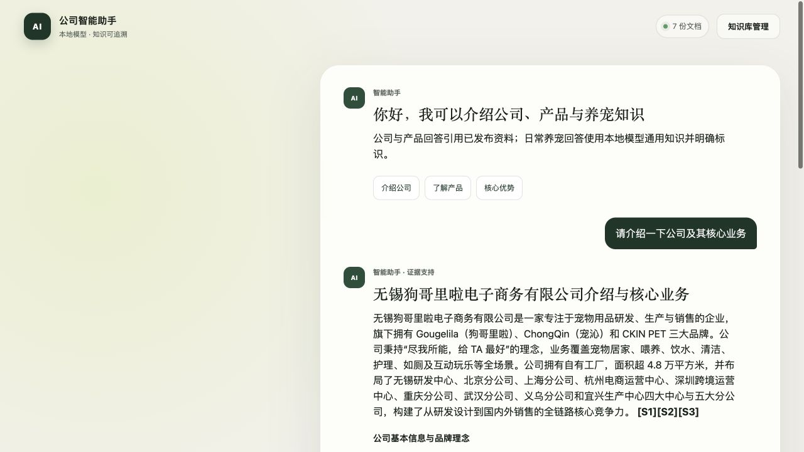
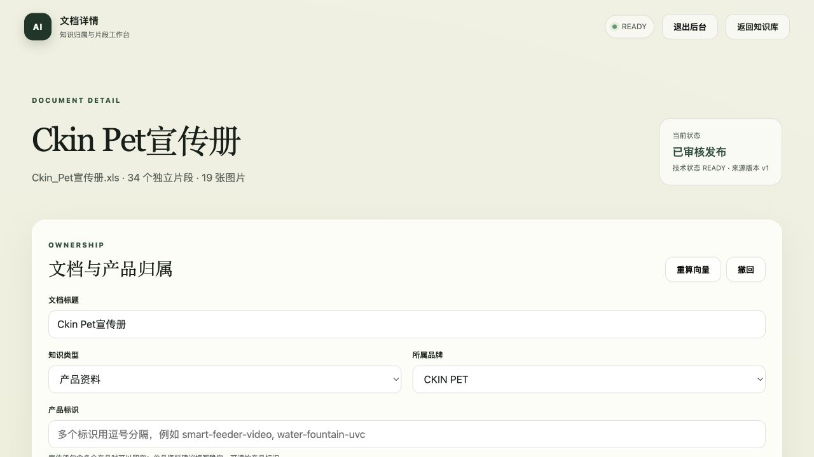

# 公司助手 · 界面与演示

这些图片复用本仓库 `docs/assets/` 中已有的真实界面截图，来自《项目功能与典型案例》所记录的实测；本次没有重新运行全部模型问答。

建议演示顺序：已发布资料 → 公司问答 → 产品图片及出处 → 管理后台文档详情。具体准备方法见 [项目 README](../../README.md)，截图背景和问答记录见 [完整功能案例](../项目功能与典型案例.md)。

`workflow.svg` 是根据仓库实现绘制的数据流程图。截图中的业务资料属于既有公开案例，部署时需要自行导入与审核资料。
